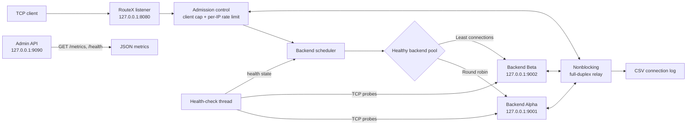
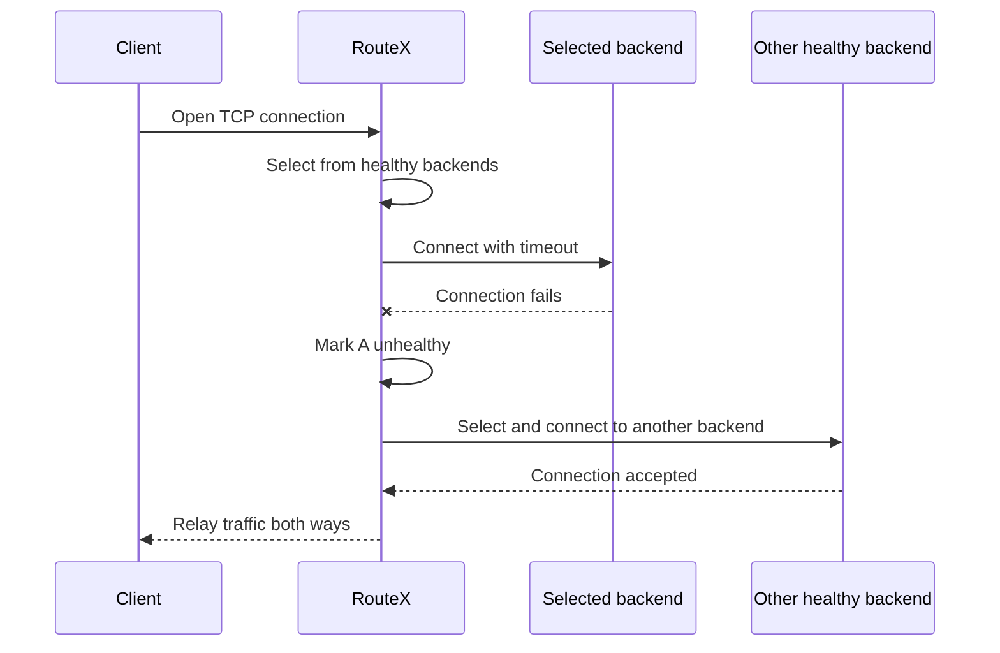

# RouteX Advanced

**A C++17 TCP load balancer with health-aware routing, backend failover, and live metrics.**

RouteX accepts TCP connections, selects a healthy backend with round-robin or least-connections scheduling, and forwards data in both directions. It also provides periodic TCP health probes, per-client rate limiting, a concurrent-client cap, JSON metrics, and CSV connection logs.


*Concept illustration for the project; this is not a screenshot or performance benchmark.*

## At a glance

- **Two routing strategies:** round robin across healthy backends, or least active connections.
- **Health-aware selection:** a background thread probes backend TCP ports and removes unhealthy backends from the selection pool.
- **Connection-failure retry:** if a selected backend cannot be connected, RouteX marks it unhealthy and tries another available backend.
- **Full-duplex TCP relay:** nonblocking sockets and `poll()` forward traffic in both directions with bounded buffers and half-close handling.
- **Admission controls:** cap active clients and limit accepted connections per client IP over a fixed 60-second window.
- **Operational visibility:** JSON counters and backend health at an optional loopback-only admin port, plus append-only per-connection CSV logs.
- **Graceful signal handling:** `SIGINT` and `SIGTERM` stop accepting new clients and wait for active worker handlers to finish their shutdown path.

## Architecture



The listener and admin endpoint bind to loopback (`127.0.0.1`). This keeps the demo local by default. A health probe checks whether a backend port accepts TCP connections; it does not verify application-level readiness.

### Backend failure and retry



If no backend is available, RouteX returns an HTTP `503 Service Unavailable` response. This response is a fallback for the demo; RouteX otherwise treats backend traffic as opaque TCP bytes and does not parse HTTP.

## Build

Requirements:

- CMake 3.16 or newer
- A C++17 compiler
- macOS or Linux (POSIX sockets)
- Python 3 to run the integration test registered by CMake

Build the two C++ executables:

```bash
cmake -S . -B build
cmake --build build
```

Run the integration test:

```bash
ctest --test-dir build --output-on-failure
```

The load balancer and demo backend are written in C++. The integration-test harness is Python and is registered only when CMake finds a Python 3 interpreter.

## Run a local demo

Open three terminals from the project directory.

**Terminal 1 — start backend Alpha:**

```bash
./build/demo_backend 9001 Alpha
```

**Terminal 2 — start backend Beta:**

```bash
./build/demo_backend 9002 Beta
```

**Terminal 3 — start RouteX:**

```bash
./build/routex 8080 \
  127.0.0.1:9001 \
  127.0.0.1:9002 \
  --algorithm round-robin \
  --admin-port 9090
```

Send requests from another terminal:

```bash
for i in 1 2 3 4 5 6; do curl -s http://127.0.0.1:8080; done
```

With round robin and both backends healthy, responses should alternate between `Hello from Alpha` and `Hello from Beta`.

Inspect live metrics and the health endpoint:

```bash
curl -s http://127.0.0.1:9090/metrics
curl -s http://127.0.0.1:9090/health
```

To see failover, stop one backend with `Ctrl+C`, wait for its health state to change, then send another request. RouteX should select the remaining healthy backend. Stop RouteX with `Ctrl+C`.

Try least-connections routing by replacing the algorithm option:

```bash
--algorithm least-connections
```

## Command-line options

```text
routex <listen_port> <IPv4:port> [<IPv4:port> ...] [options]
```

At least one backend is required. Backend addresses must be IPv4 literals.

| Option | Default | Description |
| --- | --- | --- |
| `--algorithm` | `round-robin` | Choose `round-robin` or `least-connections` for healthy backends. |
| `--admin-port PORT` | Off | Enable `/metrics` and `/health` on this loopback port. |
| `--max-clients N` | `256` | Maximum active client handlers; excess connections are closed. |
| `--rate-limit N` | `60` | Accepted connections per client IP in a 60-second fixed window. |
| `--health-ms N` | `2000` | Delay between backend health-probe rounds, in milliseconds. |
| `--idle-ms N` | `30000` | Maximum relay idle time before the connection closes. |
| `--log PATH` | `routex.csv` | Append per-connection results to this CSV file. |

Example using least connections and custom limits:

```bash
./build/routex 8080 \
  127.0.0.1:9001 \
  127.0.0.1:9002 \
  --algorithm least-connections \
  --admin-port 9090 \
  --max-clients 256 \
  --rate-limit 60 \
  --health-ms 1000 \
  --idle-ms 30000 \
  --log routex.csv
```

## Metrics and logs

`GET /metrics` returns JSON containing:

- Connection counters: `accepted`, `completed`, `failed`, and `rejected`.
- Current load: `active` client handlers.
- Traffic: `bytes_to_backends` and `bytes_to_clients`.
- Per-backend health and load: address, `healthy`, active connections, served connections, and connection errors.

These are connection/session counters, not HTTP request counters. The optional admin listener is intended for local inspection; the implementation binds it to `127.0.0.1` and does not provide authentication.

The CSV file has one row per completed or failed client session:

```text
timestamp,client,backend,status,bytes_to_backend,bytes_to_client
```

The timestamp is Unix time in seconds. This file is a connection log; it is not a separate incident-event log. CSV output is appended, so rotate or truncate it externally for long-running use.

## What the integration test covers

The integration test starts two local demo backends and a RouteX process on temporary ports. It checks:

1. Both backends become healthy.
2. Round-robin returns alternating backend responses.
3. Connection metrics increase after traffic is sent.
4. Stopping one backend is detected and subsequent traffic reaches the other backend.

The included test does not currently exercise least-connections distribution, overload rejection, per-IP rate limits, half-close edge cases, or graceful shutdown.

## Project layout

```text
RouteX_Advanced/
├── CMakeLists.txt              # Build targets and optional Python integration test
├── src/
│   ├── main.cpp                # Load balancer, health checks, relay, metrics, and logging
│   └── demo_backend.cpp        # Small HTTP-speaking TCP backend for the local demo
├── tests/
│   └── integration.py          # Local integration-test harness
├── assets/
│   └── routex-network-illustration.png
└── README.md
```

## Scope and limitations

RouteX is an advanced educational project, not a production-hardened load balancer.

- It is a layer-4 TCP proxy. It does not terminate TLS, inspect HTTP requests, or rewrite headers.
- Client connections are handled with one thread per client. The client cap limits concurrency, but thread creation and memory overhead still make this less suitable than a fixed worker pool or event loop for large deployments.
- Backend health checks test TCP connectivity, not application readiness.
- A connection that fails after it has been established cannot be migrated to another backend.
- Rate limiting is an in-process fixed-window limit keyed by client IPv4 address; it is not distributed or persistent.
- Backend addresses are IPv4 literals only; hostname resolution and IPv6 are not implemented.
- The admin endpoint has no authentication. It is loopback-only in this implementation.
- Metrics are in memory and reset when RouteX restarts. CSV logs append but are not rotated automatically.
- There is no hot configuration reload or advanced circuit breaker.

## Resume bullet

> Built a C++17 TCP load balancer with round-robin and least-connections scheduling, nonblocking bidirectional socket forwarding, periodic backend health checks and failover, per-IP rate limits, JSON connection metrics, CSV session logs, and an integration test for routing and backend failure detection.

Avoid claiming throughput, latency improvement, uptime, or production readiness without measurements and operational evidence.
